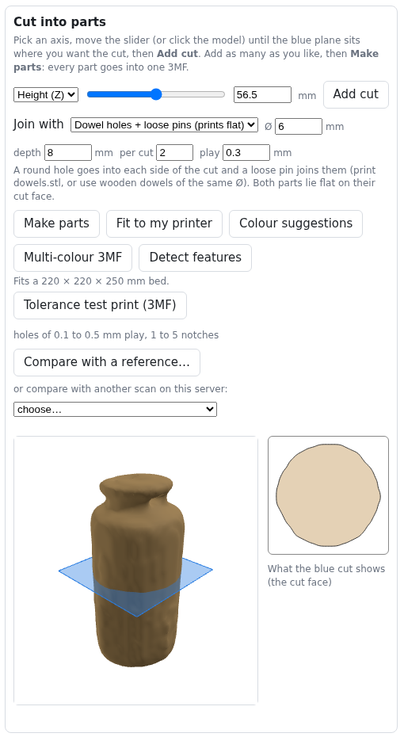

# RoomScan → BIMCraft

Scan rooms and objects with an iPhone (LiDAR + camera), send them to your own server, and get back
BIMCraft models (`.bimcraft`, `.ifc`), 3D-printable meshes (STL / 3MF), a shareable 3D page and more.

**The phone only captures. The server does the thinking**, so most new features arrive by updating the
server, with no new app to install.

> This file is kept up to date with every feature (see [Keeping this file current](#keeping-this-file-current)).
> Current: **v0.37.0** · screenshots of the web page are real; phone pictures are drawn illustrations.


---

## 1. The phone app

Install: build comes from GitHub Actions, sideload `RoomScan.ipa` with iloader (see `CLAUDE.md`).
Open **Settings (gear, top right)** and type your server address, e.g. `http://192.168.1.20:8010`.

### Measure tab (new): live distance, no scanning
Point the phone, read the distance. Works instantly: no 20 to 30 second scan.


1. Open **Measure**. The camera is live and LiDAR depth is painted over it
   (**red = near, blue = far**, up to about 4 m).
2. Aim the crosshair at a wall. The big number is the distance in m, cm and mm.
   - Green dot: steady, trust it. Orange: hold still. Red: too close (under 25 cm) or too far (over 5 m).
3. **Tap anywhere** on the picture to pin that spot. The pin is drawn exactly under your finger and
   **stays fixed on that spot in the room** while you move the phone. Add as many as you like (numbered 1, 2, 3...).
   - Each pin shows its distance from the camera right now; dashed lines show the length of each leg.
   - A pin that is out of view gets an **arrow at the screen edge** pointing the way to turn.
   - With one pin the big number is pin 1 to the crosshair, live. With two or more it is the last two pins.
4. **Pins are remembered.** The phone saves a map of the room with the pins in it when you leave the Measure tab or
   close the app. Come back to the same room and move slowly: "Looking for your saved place…" turns green and the
   pins reappear. The undo button removes the last pin, the bin removes all pins and forgets the saved room.
5. **Hold** freezes the number, **Save** keeps it in the list (the list button, bottom right). Swipe to delete.
6. The **eye** button hides or shows the depth colours.
7. **Pinch to zoom** (or the +/- at the top, 1× to 4×) to magnify the picture and place a pin precisely on a corner.
   Zoom is display only: the reading at the crosshair and your pins do not change.

#### Calibrate it against your tape (you stay in control)


Tap the small underlined line under the reading ("uncalibrated · tap to calibrate").
1. **Camera to wall**: put the tape's zero at the **back camera lens** (not the phone edge), point the crosshair
   straight at the wall, wait for the green dot, type what the tape says, **Add this check**. Do 0.5 m, 1 m, 2 m, 3 m.
2. **Between two pins**: pin both ends of something you can tape (a door width) and type its length. This also tests
   how well the phone tracked while you moved.
3. The screen shows every check with its error before and after the correction, and the typical error ("±1.2 cm"),
   which then appears under every reading. Swipe a check to delete it. **Use the correction** switches it off.
4. If the fitted scale is more than 10% from 1 it is almost always a mistyped tape value: it is **not applied** unless
   you switch on "Apply even if it looks wrong".

**Hold** now averages about a second and shows the spread ("2.317 m ± 0.4 cm"). Saved readings keep the raw sensor value
too, so a later recalibration can recompute them. Low-confidence depth pixels are ignored, and glass, mirrors and shiny
black surfaces show "Can't read this surface".

Notes: needs a LiDAR iPhone (Pro models). LiDAR is good to about ±1 cm at 1 to 3 m on matt walls; glass,
mirrors and black shiny surfaces read badly. Saved readings stay on the phone for now.

### Room tab: floor plan with walls, doors, windows
Apple RoomPlan. Walk round the room slowly pointing at walls, corners, doors. Tap Stop, then upload.
The server turns it into a BIMCraft model and plan. **Quick test (30 s)** is a short scan to check things work.

### Object tab: scan a part
Two ways, both produce a coloured 3D mesh:

- **With the ring**: put the part on the tray with the printed marker ring, hold the phone still and
  **turn the tray**. Best accuracy.
- **Without the ring**: walk the phone round the object.


Live help while you scan the ring:
- **Speed pill**: green "Good speed" (about 5 to 20°/s), orange "a little fast", red "too fast" (over 30°/s),
  plus "too slow", "too close", "too far", "ring lost". Red also buzzes.
- **Coverage dial**: three rings, outer = low camera angle, middle = mid, inner = high. Fill all three.
  The hint under it tells you what to do next ("Now hold the phone lower and turn again").
- The camera is live before you press start. The screen stays on and bright while filming.
- **Reset** returns to the start point. **Pinch** to zoom.

Tip from the real scans: every scan so far only had the middle angle. Do a low pass and a high pass too.

### Models tab: everything you scanned
- Tap a scan to see it. **Not uploaded yet? You still get a 3D preview** of what the phone captured.
- **Upload** sends it to the server. You get a "Model ready" banner when conversion finishes.
- **View in AR (real size)** shows the model at 1:1 on your table using Apple's AR viewer.

### What the app looks like
Taken automatically in the iOS Simulator on every build (no camera or LiDAR there, so scan screens have an empty picture area).

  

---

## 2. The web page (the server)

Open `http://<server>:8010` in any browser.


- **Left**: all scans, grouped by home, with search (name, home, tag, kind). **Upload file…** adds a scan by hand.
- **Top buttons** per scan: downloads (`colored.ply`, `model.stl`, `model.3mf`), Re-convert, Rename,
  Tags, Move to home, Save as zip, Share link, Delete.
- **Points / Solid surface**: switch how the 3D view is drawn. Drag to rotate, scroll to zoom,
  right-drag to pan, double-click to reset.

### Scan quality score


A 0 to 100 score for each ring scan (good 80+, fair 55+). It lists tips in plain words
("Add a pass from above") and a circle chart of which angles were covered.
Use it to decide whether to rescan before printing.

### Print preparation


- **Cut into parts**: pick an axis, slide the blue plane, **Add cut**, then **Make parts**. Parts join with
  round holes plus loose pins or dowels; you set the size and clearance.
- **Fit to my printer**: cuts the model automatically to your bed size and estimates grams of PLA,
  print time and whether supports are needed.
- **Colour suggestions** and **Multi-colour 3MF**: groups the scan colours into a few filaments.
  Check your slicer reads it (PrusaSlicer / Orca differ).
- **Tolerance test print**: a small bar with holes of 0.1 to 0.5 mm play. Print it once to learn
  your printer's fit.
- **Detect features**: finds flat faces, round bosses and holes with real sizes in mm.
  It makes no CAD file yet.

### Compare and share
- **Compare with a reference…** or **another scan**: aligns two models and paints a heat map of the
  differences (RMS in mm). Good for checking a printed part against its scan, or a part over time.
- **Share link…**: makes a read-only 3D page and STL download for anyone who can reach your server.
  **Stop sharing** revokes it.

---

## 3. The turntable ring

Printable marker ring (18 markers) that lets the server work out the camera position from every photo.
Files are in `docs/ring/`; see `docs/turntable-ring.md`. Print at 100% and keep it flat.


---

## 4. Install the server

```bash
git clone https://github.com/alon24/roomscan-bimcraft && cd roomscan-bimcraft
PORT=8010 ./deploy.sh                       # build from source
# or use the prebuilt image (Intel and Apple Silicon):
docker compose -f docker-compose.prebuilt.yml pull && docker compose -f docker-compose.prebuilt.yml up -d
```
The image is about 2.3 GB. Scans are stored in `./data`.

## 5. Not built yet

Android app (idea: a browser capture page), STEP / CAD output, whole-room AR at 1:1,
Gaussian splats, a live preview on the Room tab. Measure readings are not yet uploaded to the server.

## 6. What is untested

Everything in the phone app has only been compiled by CI, not yet confirmed on a phone. Tell me what
looks wrong and I will fix it.

---

## Changelog

| Version | What was added |
|---|---|
| 0.38.1 | Pinch to zoom on the Measure screen. |
| 0.38.0 | **Calibration** against a tape (wall and pin-to-pin checks, error before and after, correction on/off), averaged Hold with spread, depth confidence filter, unreadable-surface warning. |
| 0.37.1 | Measure pins are drawn where you tap, stay fixed in the room, are numbered, have edge arrows, and are saved with a room map. Mark A replaced by this. |
| 0.37.0 | Each build now photographs the app tabs in the Simulator. **Measure tab**: live LiDAR distance, depth colours over the camera, tap-to-pin, pin to pin, Mark A, Hold and Save. This README. |
| 0.36.0 | Ring coverage dial and hints, View in AR, Fit to my printer, multi-colour 3MF, Detect features, Compare scans, Share links, design refresh, model-ready banner |
| 0.3x | Live tray speed warning, quality score, cut parts with connectors, tolerance test, saved-scan 3D preview, screen stays on |

## Keeping this file current

Every feature or change that a person would notice gets, in the same commit:
1. a short how-to in the right section above (what it is, how to use it, what the colours or buttons mean),
2. a line in the Changelog,
3. a new screenshot if the web page changed. Re-take them with headless Chrome:
   `google-chrome --headless=new --no-sandbox --window-size=1300,2600 --screenshot=docs/img/web-scan.png "http://localhost:8010/?scan=<id>"`
   then crop. Phone pictures in `docs/img/*.svg` are illustrations; replace them with real screenshots when you have some.
