# RoomScan → BIMCraft

Scan rooms and objects with an iPhone (LiDAR + camera), send them to your own server, and get back
BIMCraft models (`.bimcraft`, `.ifc`), 3D-printable meshes (STL / 3MF), a shareable 3D page and more.

**The phone only captures. The server does the thinking**, so most new features arrive by updating the
server, with no new app to install.

> This file is kept up to date with every feature (see [Keeping this file current](#keeping-this-file-current)).
> Current: **v0.44.0** · screenshots of the web page are real; phone pictures are drawn illustrations.

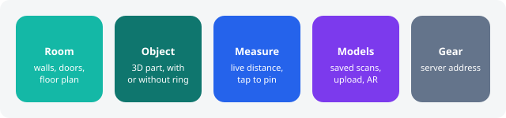

---

## 1. The phone app

Install: build comes from GitHub Actions, sideload `RoomScan.ipa` with iloader (see `CLAUDE.md`).
Open **Settings (gear, top right)** and type your server address, e.g. `http://192.168.1.20:8010`.

- **Leaving a scan stops it.** Switching tabs (or opening Settings) in the middle of a scan stops it exactly as **Stop** does, and
  the line "Stopped because you left the scan screen" appears: what was captured is kept, so you can still **Upload** or **Save** it.
  An Object Capture that was capturing is finished and built from the photos taken so far; one that had not started is cancelled.
- **Storage (Settings, at the bottom).** Shows where the app keeps saved scans, temp files and caches (tap **Copy** for a path) and
  how much space each takes. **Show in Files** opens the Files app at On My iPhone, RoomScan (saved scans are in `SavedScans`).
  **Delete temp files** and **Delete all saved scans** (asks twice: confirm, then type DELETE) each say first how much they free.
  A scan you are still working on is never deleted; temp files older than a day are deleted when the app starts, and a scan's temp
  files go as soon as you Save it or start a new one.

### Measure tab: live distance, no scanning
Point the phone, read the distance. Works instantly: no 20 to 30 second scan.

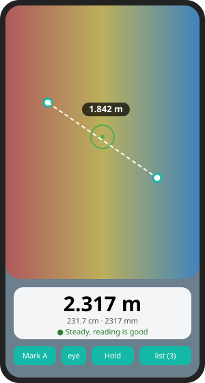

1. Open **Measure**. The camera is live and LiDAR depth is painted over it
   (**red = near, blue = far**, up to about 4 m).
2. Aim the crosshair at a wall. The big number is the distance in m, cm and mm.
   - Green dot: steady, trust it. Orange: hold still. Red: too close (under 25 cm) or too far (over 5 m).
3. **The bullseye in the middle makes the pin.** Aim it at the spot (the picture can be zoomed to place it exactly), then
   **tap the bullseye** (or the viewfinder-plus button). The pin stays **fixed on that spot in the room** while you move.
   Tapping anywhere else on the picture does nothing, so you can't pin by accident. Pins are numbered and **independent**:
   nothing is joined unless you say so. A pin out of view gets an **arrow at the screen edge** pointing the way to turn.
   **Tap a pin's bullseye** to open its menu: select, measure from it to the crosshair, keep a line to the selected pin,
   name it, **move it to the crosshair**, or delete it.
4. **Choose what to measure by selecting pins**, from a pin's menu (**Select to measure**) or by ticking it in **Manage pins**.
   Selected pins turn amber.
   - 1 selected: live distance from that pin to the crosshair.
   - 2 selected: the distance between them, plus how much of it is along the floor and how much is height.
     **Keep a line between these two** leaves a measured line drawn there for good.
   - 3 or more: area, perimeter and the angle at each pin, in the order you picked them.
   - Placing a new pin while one pin is selected adds it to the pick, so pin, pin gives a distance at once.
     **Clear selection** unpicks everything but keeps the pins.
5. **Manage pins** (the pin button, bottom row): tick pins to select, swipe a pin to **name** it ("left wall") or delete it,
   link or unlink the two ticked pins, see all kept lines, untick all, delete all pins.
6. **Pins are remembered.** The phone saves a map of the room with the pins, names and links when you leave the Measure
   tab or close the app. Come back to the same room and move slowly: "Looking for your saved place…" turns green and
   everything reappears.
7. **Hold** freezes the number, **Save** keeps it in the list (the list button, bottom right). Swipe to delete.
8. The **eye** button hides or shows the depth colours.
9. **Pinch to zoom** (or the +/- at the top, 1× to 4×) to magnify the picture and place a pin precisely on a corner.
   Zoom is display only: the reading at the crosshair and your pins do not change.

#### Calibrate it against your tape (you stay in control)
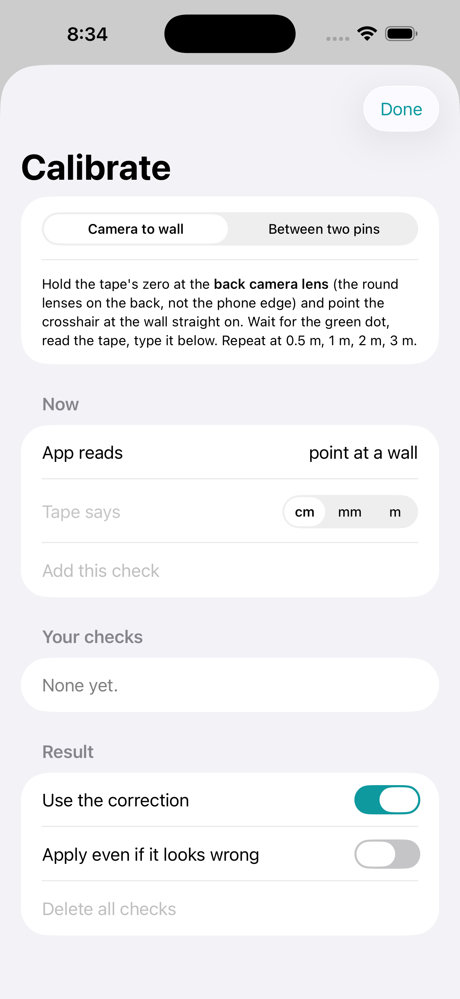

Tap the small underlined line under the reading ("uncalibrated · tap to calibrate").
1. **Camera to wall**: put the tape's zero at the **back camera lens** (not the phone edge), point the crosshair
   straight at the wall, wait for the green dot, type what the tape says, **Add this check**. Do 0.5 m, 1 m, 2 m, 3 m.
2. **Between two pins**: pin both ends of something you can tape (a door width) and type its length. This also tests
   how well the phone tracked while you moved.
3. The screen shows every check with its error before and after the correction, and the typical error ("±1.2 cm"),
   which then appears under every reading. Swipe a check to delete it. **Use the correction** switches it off.
4. If the fitted scale is more than 10% from 1 it is almost always a mistyped tape value: it is **not applied** unless
   you switch on "Apply even if it looks wrong".

**Hold** now averages about a second and shows the spread ("2.317 m ± 0.4 cm"). Saved readings keep the raw sensor value
too, so a later recalibration can recompute them. Low-confidence depth pixels are ignored, and glass, mirrors and shiny
black surfaces show "Can't read this surface".

Notes: needs a LiDAR iPhone (Pro models). LiDAR is good to about ±1 cm at 1 to 3 m on matt walls; glass,
mirrors and black shiny surfaces read badly. Saved readings stay on the phone for now.

### Room tab: floor plan with walls, doors, windows
Apple RoomPlan. Walk round the room slowly pointing at walls, corners, doors. Tap Stop, then upload.
The server turns it into a BIMCraft model and plan. **Quick test (30 s)** is a short scan to check things work.

#### Room from one spot: sweep the phone (small or cluttered rooms)
Room tab, **From one spot**. You don't walk round the room: stand in the middle, tap **Start scan**, and turn slowly on the spot.
- A dial shows where the camera has looked: **outer ring = the walls** all the way round, **middle = the ceiling**, **inner = the floor**.
  Fill the outer ring first (turn slowly), then tilt up, then tilt down. The hint under the dial tells you what's next.
- It warns "You are 40 cm from where you started" if you wander off. Small steps are fine.
- The phone keeps a photo, the LiDAR depth and the camera's direction twice a second. The server turns them into a 360° picture of
  the room and a model of it seen from that spot, with its measurements.

### Live guided capture (two-way, optional)
While you scan a room the phone can send each frame to the server **as it is taken**. The server works out what is still missing and
sends a small map back: where you are, what is covered and what is thin, and a short list of what to capture next, in plain words
("The walls to the right are not seen yet. Turn that way slowly and film them."). The phone draws the map and markers; the thinking
stays on the server. Because the frames are already on the server when you stop, there is **no big upload at the end**.

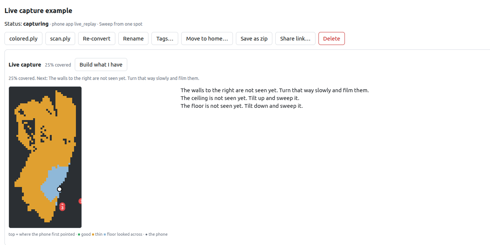

- **Offline always works.** Live is an extra. With no network the phone captures exactly as before and uploads later. If the
  connection drops mid-scan the phone keeps scanning and sends what is missing when it is back. After **Stop**, **Upload** first
  sends the frames the server does not have yet and asks it to build (the line under the buttons says "Sending N frames…", then
  "building"). If the frames cannot be sent within 2 minutes, or the build fails or takes over 15 minutes, the phone deletes the half-sent scan on the server and uploads the whole
  scan the ordinary way; if even that fails it is kept on the phone (Models, On this phone). The server also accepts the missing
  frames with `POST /api/scans/{id}/frames` (used by `tools/live_replay.py --offline-after`), but the app does not use it.
- **Save on the phone instead.** Tapping **Save** after a live scan removes its draft on the server, so it is not built there after
  10 minutes and then uploaded a second time from the phone. Upload it later from Models, On this phone. If the server had already
  started building it (you tapped Upload first), the draft is kept.
- **Watch it on the web page.** Open the scan page while someone scans: the scan appears by itself with a **Live capture** panel:
  the top-down map (green = seen well, orange = thin or far, blue = floor looked across, white dot = the phone), the percent
  covered, the numbered things to capture next, and **Build what I have** for a capture that was left unfinished (it also builds
  by itself after 10 minutes without news).
- **What the needs are.** Directions of the room never faced (walls, ceiling, floor, as on the phone's dial), holes in the outline,
  walls seen only from more than 3 m or from fewer than 3 frames, a ceiling or floor hardly seen, blurry frames. At most 5; a need
  keeps its place until you have satisfied it.
- **Patch a scan you already have** (server and `tools/live_replay.py --resume-scan`; the phone app does not offer it yet).
  Start a capture on an existing room scan ("add more"). After a few frames the server finds
  where the new session sits in the first one (gravity is shared, so only a turn and a shift are unknown; it matches the LiDAR
  geometry), tells the phone, and from then on the map shows what the first scan already covered, in the phone's own frame. The new
  frames are fused with the old ones into one rebuilt model. If it cannot tell (a bare room, or a room that looks the same from two
  sides) it says so and asks you to film something distinctive instead of guessing. The same works for frames captured offline:
  `POST /api/scans/{id}/add` returns `{aligned, rms_mm, message}` and leaves the old model alone if it cannot match.
- **Try it without a phone:** `python tools/live_replay.py --scan-dir data/scans/<id> --kind sweep --speed 2 --finish` streams an
  existing scan's frames the way the phone would (`--drop-after 12` cuts the connection and resumes; `--resume-scan <id>` patches).
  The protocol is in `docs/live-guide.md`.

### Object tab: scan a part
Two ways, both produce a coloured 3D mesh:

- **With the ring**: put the part on the tray with the printed marker ring, hold the phone still and
  **turn the tray**. Best accuracy.
- **Without the ring**: walk the phone round the object.

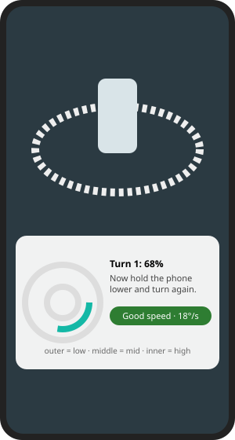

Live help while you scan the ring:
- **Speed pill**: green "Good speed" (about 5 to 20°/s), orange "a little fast", red "too fast" (over 30°/s),
  plus "too slow", "too close", "too far", "ring lost". Red also buzzes.
- **Coverage dial**: three rings, outer = low camera angle (**under 32°**), middle = mid (32° to 50°), inner = high (over 50°). Fill all three.
  A live **"Camera angle 38° (middle)"** label tells you which ring you are filling right now: to fill the outer ring, lower the phone
  until it reads under 32°. (The old edge was 25°, which real scans never reached, so the outer ring stayed empty.)
  The hint under it tells you what to do next ("Now hold the phone lower and turn again").
- The camera is live before you press start. The screen stays on and bright while filming.
- **Reset** returns to the start point. **Pinch** to zoom.

Tip from the real scans: every scan so far only had angles between 33° and 44°. Watch the angle label and go clearly lower (and higher) on the other passes.

### Photo Measure (any phone, no LiDAR, installable web app)
Open `http://<server>:8010/photo.html` on **any** phone or computer (Android, iPhone, laptop). No app to install.
1. Lay a **bank card** (or A4 / A5 / Letter paper, or any object whose size you know) flat on the same surface as the thing
   you want to measure. Photograph both from straight above.
2. **Take a photo** (or choose one). The server finds the card by its four corners and draws them in green. If it can't, drag
   the four green corners onto the card's corners yourself.
3. **Tap two points** on the photo: slide your finger to place each one exactly (a magnifier shows), lift to set it. The
   distance appears in mm and cm. Make as many as you like; **Undo last** / **Clear all**.
4. **Straighten photo** gives a top-down picture to scale that you can download.
Only things lying flat on the same surface as the card are measured correctly, and about 1% accuracy needs the photo taken
straight above (it warns if the angle is steep). Good for glass, mirrors, shiny things and anything LiDAR can't read.
**Install it:** over HTTPS (or `localhost`) your browser offers "Install app" / "Add to Home screen", and it then opens like an
app. On a plain `http://192.168...` address it works in the browser but the browser won't offer the install button.
Everything runs on your own server (OpenCV finds the card); nothing leaves it.

### What the server builds from a sweep (360 picture and room model)
For a scan made with **From one spot** (above) the server notices that every frame was taken from about the same spot (the app also
flags it as "Sweep from one spot") and builds, from the photo, the LiDAR depth and the camera direction of each frame:

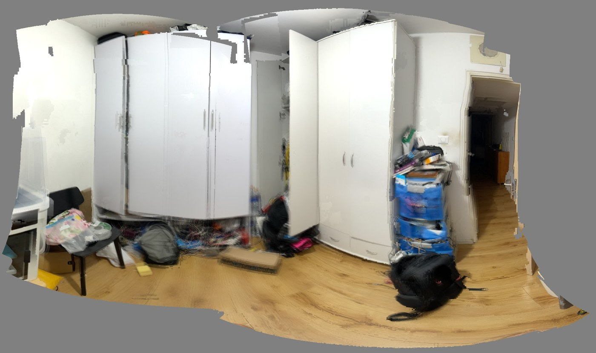

- **A 360 degree panorama picture** of the room: the photos stitched by their camera directions, brightness-matched so there are no stripes,
  grey where nothing was seen. Open it with the **Panorama** button on the scan page: drag to look around, scroll to zoom, **Download JPG**.
- **A room model seen from the middle**: the depth of every frame is fused into one depth image around where you stood, meshed, flattened
  where it lies on a wall, floor or ceiling and coloured from the panorama. The scan page opens it **from the middle** (button **From outside**
  to orbit it). Furniture stays as it is; edges against the wall behind are not stretched.
- **Numbers**: distance from where you stood to the front, right, back and left walls (front = where you first pointed the phone),
  to the floor and the ceiling, and the **room's width, length and height**. They are listed under the model and drawn as labels in the 3D view,
  with how much of the room was seen. A wall not in the sweep shows "not seen": turn the whole way round to get it.
- The red camera arrows on the model are now one **"you stood here"** marker when you turned on the spot (28 arrows on one point looked like a red star).

How good: on a synthetic box room the width, length and height come out within 2%. On your real scan (28 frames, about a third of the room
swept) the height was 2.3 m, the front and left walls were found, the right and back walls were not in the sweep.
Limits: LiDAR reaches about 5 m (a bigger room shows walls as "not seen"); glass and mirrors read badly; the phone must stay within about
35 cm of one spot (a bigger move is treated as an ordinary room scan, or set `"sweep": false` in the scan info to force that).
Other 3D room scans (walking round) now get brightness-matched, blended photo colours too: neighbouring colour jumps are about 16% smaller
than before and the worst ones 22% smaller.

### Models tab: everything you scanned
- Tap a scan to see it. **Not uploaded yet? You still get a 3D preview** of what the phone captured.
- **Upload** sends it to the server. You get a "Model ready" banner when conversion finishes.
- **View in AR (real size)** shows the model at 1:1 on your table using Apple's AR viewer.

### What the app looks like
Taken automatically in the iOS Simulator on every build (no camera or LiDAR there, so scan screens have an empty picture area).

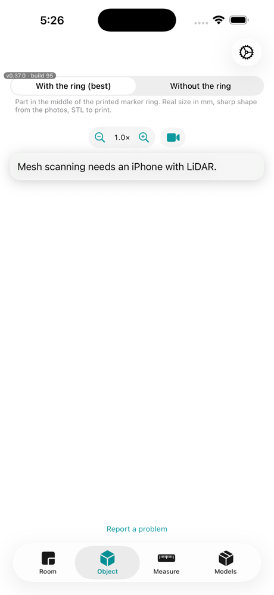 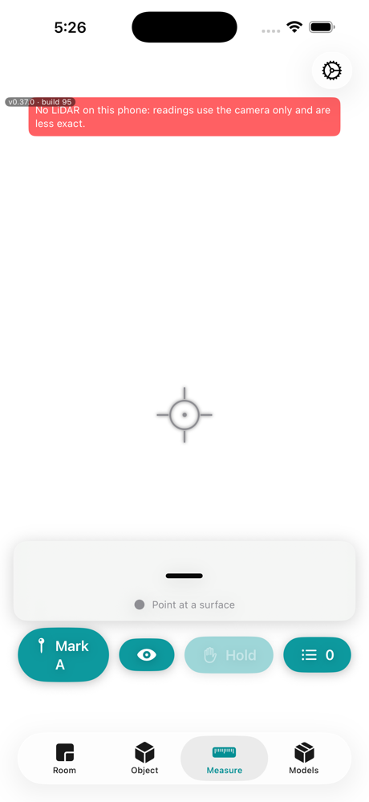 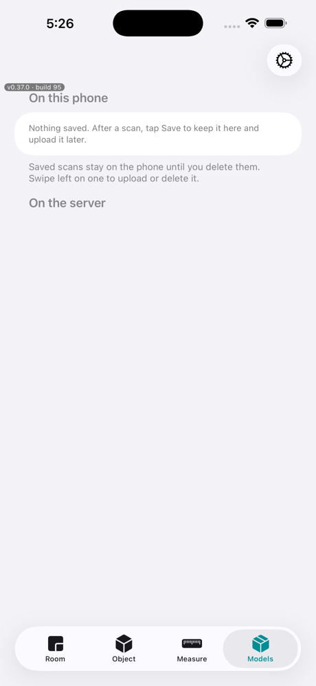

---

## 2. The web page (the server)

Open `http://<server>:8010` in any browser.

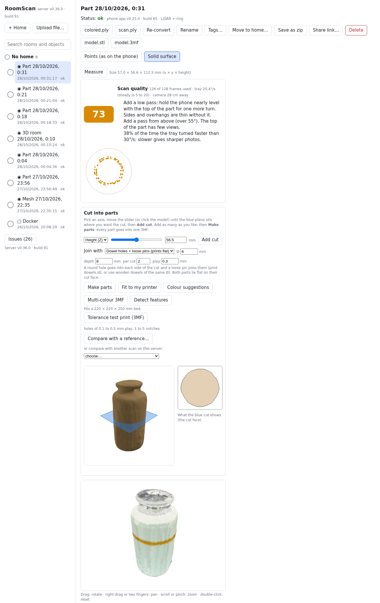

- **Left**: all scans, grouped by home, with search (name, home, tag, kind). **Upload file…** adds a scan by hand.
- **Top buttons** per scan: downloads (`colored.ply`, `model.stl`, `model.3mf`), Re-convert, Rename,
  Tags, Move to home, Save as zip, Share link, Delete.
- **Points / Solid surface**: switch how the 3D view is drawn. Drag to rotate, scroll to zoom,
  right-drag to pan, double-click to reset.

### Storage: find the scans folder, clear temp and rebuildable files

**Storage** at the bottom of the left panel shows where the scans are on the server computer, how much room scans, rebuildable
files, app files and temp files take, and has a **Copy** button for each path and for `xdg-open <data>/scans`. A web page cannot
open a folder itself: paste the path in a file manager, or run `tools/open-data.sh` on the server computer.
- **Delete temp files**: leftovers older than 10 minutes in the server's own temp folder.
- **Delete rebuildable files (keeps every scan)**: panoramas, quality reports, features, colour suggestions, AR models and cut parts.
  They are made again when needed (cut parts need a new cut). Scans still being captured are left alone.
- **Delete ALL scans**: type `DELETE ALL` to confirm. The app files in `data/apps` stay.

The server does the deleting, because `data/` belongs to root on the host. `deploy.sh` passes the host path as `DATA_HOST_PATH`.

### Scan quality score
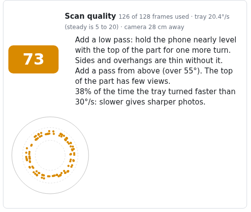

A 0 to 100 score for each ring scan (good 80+, fair 55+). It lists tips in plain words
("Add a pass from above") and a circle chart of which angles were covered.
Use it to decide whether to rescan before printing.

### Print preparation

#### The cut tool (like Orca Slicer's cut dialog)
Click **Open the cut tool (big view)** under a scan's "Cut into parts". It opens a large panel (about 92% of the
screen; **Full screen** and **Esc** to close). Open it straight from a link with `?scan=<id>&cut=1` (add `&rx=-18&ry=14&pos=62`
to preset the plane).

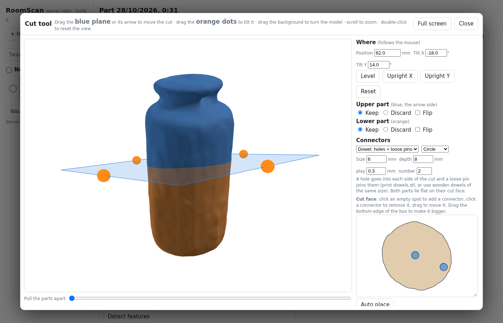

1. **Move the cut with the mouse.** Drag the blue plane (or its arrow) up and down. Drag the **orange dots** on its edges to
   tilt it (it snaps to level or upright when you get close). Drag the background to turn the model, scroll to zoom,
   double-click to reset the view. The **Where** boxes (position, tilt X, tilt Y) follow the mouse, and you can type in them;
   **Level**, **Upright X**, **Upright Y** and **Reset** jump to the usual cuts.
2. **See both parts.** The upper part (the side the arrow points to) is blue, the lower part orange. **Pull the parts apart**
   moves them away from each other along the cut.
3. **Upper part / Lower part**: **Keep** or **Discard** each, and **Flip** to print it with the cut face up instead of on the bed.
4. **Connectors**: Dowel (a hole in each part plus a loose pin), Plug (a peg on one part), Key (a square plug) or None.
   Pick the shape (circle, square, triangle, hexagon), size, depth and play (clearance). Connectors need both parts kept.
5. **Cut face** (below the options; drag its bottom edge to make it bigger): the outline of the cut with the connectors drawn
   to scale. **Click an empty spot** to add a connector, **click a connector** to remove it, **drag** one to move it.
   Red means too close to the edge (it keeps 2 mm of material). **Auto place** goes back to automatic spots.
   Moving or tilting the plane starts a new face, so the spots start automatic again.
6. **Perform cut** makes the parts. The real parts then show in the view, pulled apart (**Back to editing** returns to the
   plane), with the downloads (`model_parts.3mf`, each part, `dowels.stl`), a filament and time estimate, and a note about
   supports. **Add to cut list** keeps a plane and lets you cut again somewhere else; all listed planes are cut together.

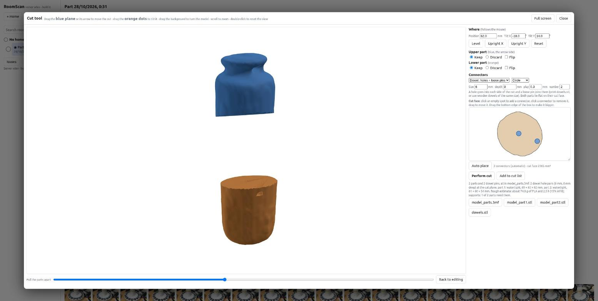

Limits: very dense meshes are thinned for the preview (the cut itself uses the full model); a connector needs a cut face
at least size + 4 mm across; connectors on strongly curved or thin cuts can fail, and the message says so.

- **Fit to my printer**: cuts the model automatically to your bed size and estimates grams of PLA,
  print time and whether supports are needed.
- **Colour suggestions** and **Multi-colour 3MF**: groups the scan colours into a few filaments.
  Check your slicer reads it (PrusaSlicer / Orca differ).
- **Tolerance test print**: a small bar with holes of 0.1 to 0.5 mm play. Print it once to learn
  your printer's fit.
- **Detect features**: finds flat faces, round bosses and holes with real sizes in mm.
  It makes no CAD file yet.

### Compare and share
- **Compare with a reference…** or **another scan**: aligns two models and paints a heat map of the
  differences (RMS in mm). Good for checking a printed part against its scan, or a part over time.
- **Share link…**: makes a read-only 3D page and STL download for anyone who can reach your server.
  **Stop sharing** revokes it.

---

## 3. The turntable ring

Printable marker ring (18 markers) that lets the server work out the camera position from every photo.
Files are in `docs/ring/`; see `docs/turntable-ring.md`. Print at 100% and keep it flat.

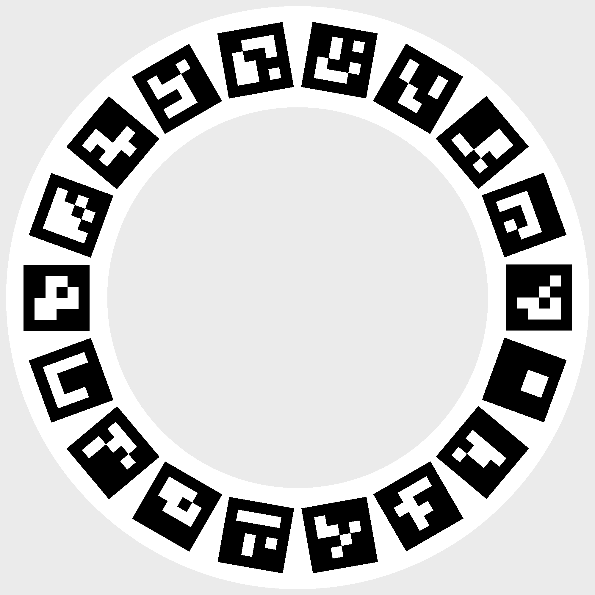

---

## Get the apps from your own server

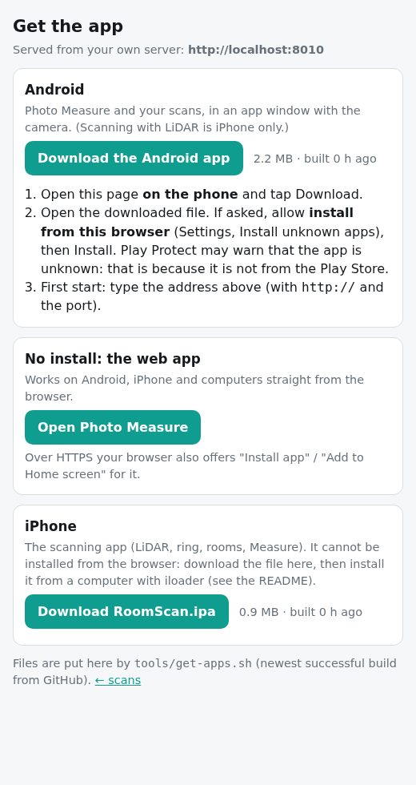
Open `http://<server>:8010/apps.html`. It lists the **Android app (APK)** and the **iPhone app (IPA)** that this server holds, with
download buttons and install steps, and a link to the no-install web app.
- Put the newest builds on the server with `./tools/get-apps.sh` (downloads the last successful iPhone and Android builds from
  GitHub into `data/apps/`; needs `gh` logged in). Run it after each build, or add it to your routine.
- **Android app** (`android/`, built by GitHub Actions to `RoomScan.apk`): a thin window around this server's web app. It opens
  Photo Measure, with the camera and photo picker working, and asks for the server address on first start. No LiDAR scanning
  on Android. Sideload it: download on the phone, allow "install from this browser", install. Play Protect may warn because it
  is not from the Play Store. It is signed with a debug key, so an update installs over the old one only if it was built the same way.
- **iPhone app**: cannot be installed from a browser. Download the IPA from the page, then install it with iloader.

## 4. Install the server

```bash
git clone https://github.com/alon24/roomscan-bimcraft && cd roomscan-bimcraft
PORT=8010 ./deploy.sh                       # build from source
# or use the prebuilt image (Intel and Apple Silicon):
docker compose -f docker-compose.prebuilt.yml pull && docker compose -f docker-compose.prebuilt.yml up -d
```
The image is about 2.3 GB. Scans are stored in `./data`.

## 5. Not built yet

STEP / CAD output, whole-room AR at 1:1, Gaussian splats, patching an existing scan from the phone.
Measure readings are not yet uploaded to the server.

## 6. What is untested

Ring scans and sweeps have been tried on a real iPhone 13 Pro. Anything newer (live guided capture in particular) has only
been compiled by CI until it is tried on a phone. Tell me what looks wrong and I will fix it.

---

## Changelog

| Version | What was added |
|---|---|
| 0.44.x (server, web) | **Storage** panel (paths to copy, sizes, clear temp / rebuildable files / all scans) and `tools/open-data.sh`; errors show in a message bar instead of a browser alert; a scan opened by a click or link is no longer replaced by a live capture (a **Live capture running: show it** button appears instead); cuts through many islands cap their connectors; colour suggestions say when a model has no colours. |
| 0.44.x (app, later) | Leaving the tab mid-scan stops the scan and keeps it; Save on a live scan removes the server draft (no duplicate); **Storage** in Settings (paths, sizes, Show in Files, delete temp files / all saved scans); temp photo folders are deleted after Save, New scan and at launch; Upload after Save marks the saved copy uploaded; big uploads stream from a file instead of memory; photos, the depth cloud and the ring speed are worked out off the main thread. |
| 0.44.x (app) | After Stop, a live room scan shows what the link is doing (sending the last frames, building, server errors); live guidance, problem reports and ring sync work before the server address was ever changed in Settings; no repeated frames when another tab takes the camera. Removed scan modes no tab could open (guided object, LiDAR turntable, photo turntable). |
| 0.44.x (server) | Floor plans: L-shaped rooms and rooms whose walls do not close now convert (**Re-convert** scans that failed before); walls now run clockwise so they face out. Photo Measure routes answer 400 for bad corners instead of failing. |
| 0.44.0 (server) | **Live guided capture**: two-way WebSocket with the phone (live map and what-to-capture-next), live panel and Build what I have on the scan page, patching an existing scan by registering a new session to it, offline routes `/frames` and `/add`, uploads of any size, `tools/live_replay.py`. |
| 0.43.0 | **Room from one spot**: sweep the phone from the middle; 360 degree panorama (viewer and download), depth-panorama room model with flat walls, room width, length and height and wall distances, a 'you stood here' marker instead of a red star of camera arrows, blended brightness-matched colours for room scans. |
| 0.42.2 | Ring dial bands now low <32° / mid 32-50° / high >50° with a live camera-angle label; Room tab **From one spot** sweep mode with its own coverage dial (walls, ceiling, floor); uploads over 1000 files accepted (server). |
| 0.42.1 | Measure: only the bullseye in the middle creates a pin (tap it), taps elsewhere do nothing; tap a pin to open its menu. |
| 0.42.0 | **Android app** (APK built in CI, thin shell for Photo Measure) and a **Get the app** page on the server (`/apps.html`) that hands out the APK and IPA. |
| 0.41.0 | **Photo Measure** web app (`/photo.html`): measure from a photo with a bank card or paper as the ruler, works on Android and iPhone, installable (PWA), straighten to a top-down view. |
| 0.40.0 | **Cut tool like Orca Slicer's**: big panel, move and tilt the cut plane with the mouse, two-colour preview with pull-apart, keep/discard/flip, connector shapes (circle, square, triangle, hexagon), click to add, move or remove connectors on the cut face, any-angle cuts. Server: `/cut/preview`, `/cut/plane`. |
| 0.39.1 | Bullseye centred exactly on the pinned point, tap it for a menu (select, name, move to crosshair, link, delete), pin-at-crosshair button. |
| 0.39.0 | **Pin management**: pins are independent, tap to select, measure between any selection (distance, floor and height parts, area, perimeter, angles), keep chosen links, name and delete pins, all remembered with the room map. |
| 0.38.1 | Pinch to zoom on the Measure screen. |
| 0.38.0 | **Calibration** against a tape (wall and pin-to-pin checks, error before and after, correction on/off), averaged Hold with spread, depth confidence filter, unreadable-surface warning. |
| 0.37.1 | Measure pins are drawn where you tap, stay fixed in the room, are numbered, have edge arrows, and are saved with a room map. Mark A replaced by this. |
| 0.37.0 | Each build now photographs the app tabs in the Simulator. **Measure tab**: live LiDAR distance, depth colours over the camera, tap-to-pin, pin to pin, Mark A, Hold and Save. This README. |
| 0.36.0 | Ring coverage dial and hints, View in AR, Fit to my printer, multi-colour 3MF, Detect features, Compare scans, Share links, design refresh, model-ready banner |
| 0.3x | Live tray speed warning, quality score, cut parts with connectors, tolerance test, saved-scan 3D preview, screen stays on |

## Keeping this file current

Every feature or change that a person would notice gets, in the same commit:
1. a short how-to in the right section above (what it is, how to use it, what the colours or buttons mean),
2. a line in the Changelog,
3. a new screenshot if the web page changed. Re-take them with headless Chrome:
   `google-chrome --headless=new --no-sandbox --window-size=1300,2600 --screenshot=docs/img/web-scan.png "http://localhost:8010/?scan=<id>"`
   then crop. Phone pictures in `docs/img/*.svg` are illustrations; replace them with real screenshots when you have some.
