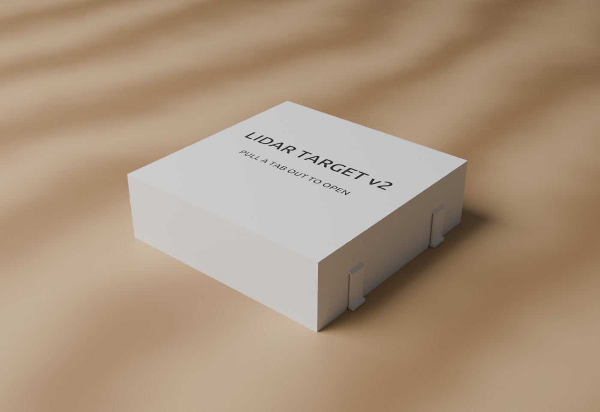
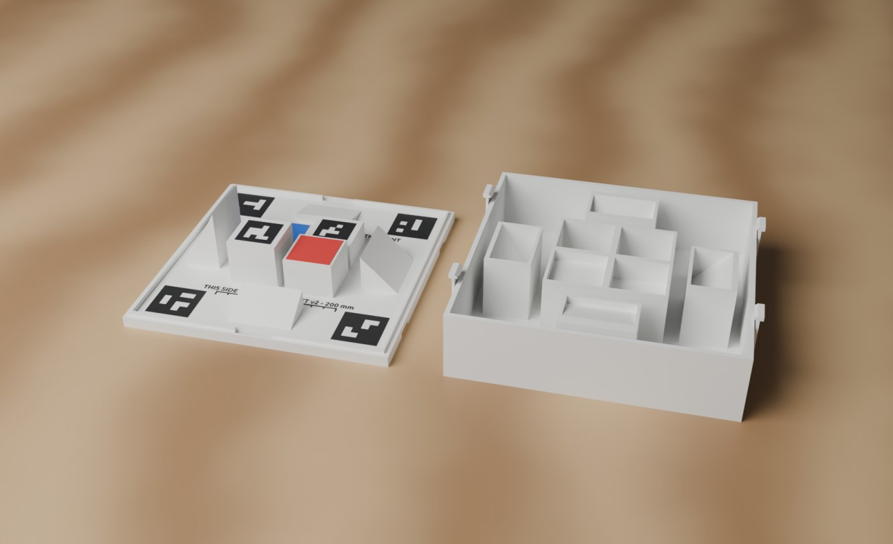
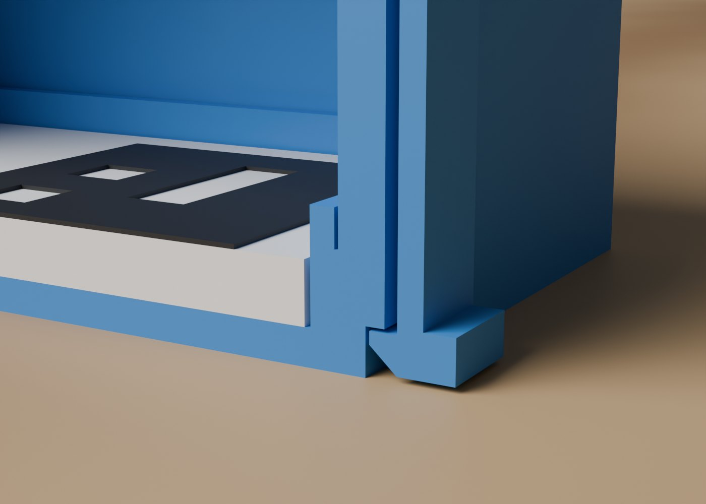
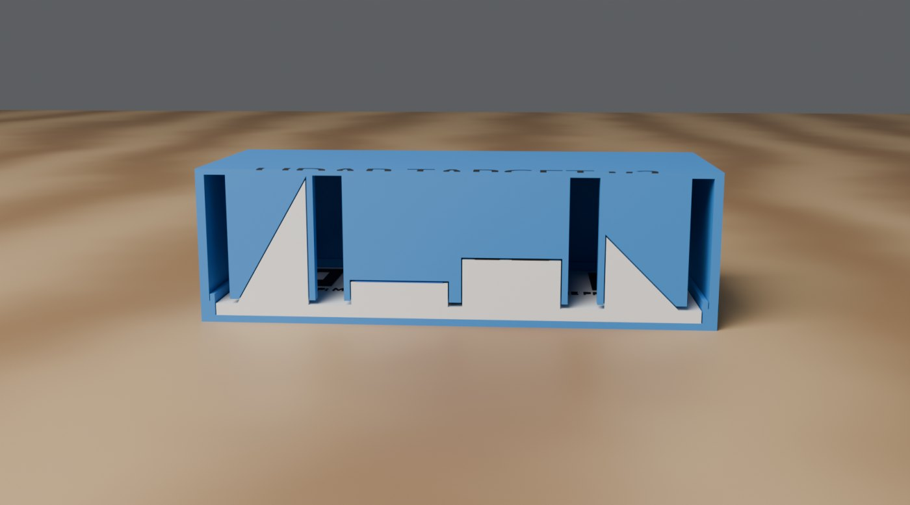

# Carry case for the LiDAR target (lidar-case)

A two-part box for carrying the [LiDAR calibration print](lidar-target.md) without breaking the wedges or scratching the
markers. The **tray** holds the plate. The **lid** is the print's negative: a socket for every pad and wedge, 0.5 mm bigger
all round, so the print sits still inside. Four **snap tabs** on the lid click into notches in the tray to close it.

 

Files (in `prints/lidar-case/`; the 3MFs are also served at `http://<server>/prints/`):

| File | What |
|---|---|
| `lidar-case-tray.3mf` | **Print this.** The tray, white PLA (filament 1), floor down |
| `lidar-case-lid-2colour.3mf` | **And this.** The lid, already upside down for printing: white (filament 1), with the label inlaid in black (filament 2) |
| `lidar-case-tray.stl`, `lidar-case-lid-white.stl`, `lidar-case-lid-black.stl` | The same parts as meshes, standing as they do in use (the lid the right way up) |
| `lidar-case.step` | For CAD |
| `lidar-case.solidcraft` | The SolidCraft design (every feature named) |
| `case_*.jpg` | Pictures: closed, open, cut in half, the snap tab close up |

## 1. Printing (Snapmaker U1)

1. **Tray**: open `lidar-case-tray.3mf` in Snapmaker Orca. 213 x 213 x 12 mm. White PLA, 0.2 mm layers, 3 walls, 15%
   infill, no supports.
2. **Lid**: open `lidar-case-lid-2colour.3mf`. It is already lying on its top (224 x 213 x 64 mm with the tabs; the U1 takes
   270 x 270). White in slot 1, black in slot 2. The label is the first two layers (0.4 mm), flush with the top, so print the
   **first layer slowly** to keep the letters clean. 0.2 mm layers, 3 walls, **10% infill** (the sockets are big solid
   blocks in the file; the infill keeps them light), no supports: every overhang is under 2.5 mm or at 45°.
3. Each part needs its own plate: together they don't fit on the U1's bed.
4. Check that the four tabs came out straight and are not stuck to the lid wall: you should see light through the 1 mm gap behind each one.

## 2. Using it

- **Pack:** lay the print in the tray (any way round fits the tray). The lid fits only one way round the print: hold it so
  its label reads the same way as the text on the print, and press it straight down. Each tab rides over the tray's edge and
  **clicks** into its notch.
- **Open:** pull the thumb tab at the bottom of one tab outwards (about 1.5 mm) and lift that side. Then do the same on the
  other side.
- **Take the print out:** two finger notches in the middle of two sides of the tray let you get under the plate's edge.
- The print can move at most 0.5 mm inside the closed case, so it won't rattle much. A 1-2 mm sheet of felt or foam in the
  tray takes up the rest.

The cut-in-half picture (case shown blue so you can tell it from the print) shows every pad and wedge in its own socket:

## 3. Geometry (for changing it)

Units mm. Same origin as the print: the plate's bottom face, so **the print's coordinates are the case's coordinates** (+Y
towards markers 40 and 41). Clearance `c = 0.5` everywhere the print meets the case.

| Part | Where | Size |
|---|---|---|
| Tray block | x, y in [-106.5, 106.5], z in [-3, 6] | 213 x 213, floor 3 mm |
| Plate pocket | x, y in [-100.5, 100.5], z from 0 | 201 x 201 (plate 200 + 2c) |
| Lip (aligns the lid) | ring between 201 and 205 square, z 6 to 9 | 2 mm wide, 3 mm high |
| Finger notches | x in [-15, 15], \|y\| 100.5 to 104.5, z 1 to 9.5 | through the lip, 2 mm wall left outside |
| Latch notches (tray) | \|x\| 105 to 107, y = ±60 ± 9, z -3 to 0.8 | open at the bottom, 0.8 high ledge for the hook |
| Lid shell | x, y in [-106.5, 106.5], z 6 to 61.4 | walls 3.7 (inside 205.6, 0.3 over the lip), top 2.4 (inside ceiling at z = 59) |
| Centre socket | x, y in [-46, 46], z 7 to 59 | four pad pockets 41 x 41, each to its pad top + marker/patch 0.4 + c (15.9, 25.9, 35.9, 45.9) |
| Wedge sockets | 36 x 56 blocks over each wedge (centre ±76), z 7 to 59 | pocket = the wedge grown by c: inner face at 60.5, slope moved out by c / cos(angle) |
| Snap tab | \|x\| 107.5 to 109.5 (1 mm off the wall), y = ±60 ± 8, z -2.5 to 31 | 2 mm thick, 16 wide, flexes over 33 mm; joined to the wall by a 45° gusset at z 31 to 34 |
| Hook | inward from the tab's foot to \|x\| = 105.3, flat top at z = 0.5, 45° lead-in below | catches 1.2 mm under the tray's ledge, 0.3 mm play |
| Thumb tab | \|x\| 109.5 to 112, z -2.5 to 1 | to pull the tab out |
| Label | inlaid in the lid top, z 61.0 to 61.4 | "LIDAR TARGET v2" (Ubuntu Bold, 14 mm caps) and "PULL A TAB OUT TO OPEN" (7 mm) |

Why the tabs are like that: the hook has to move 1.2 mm to pass the tray's edge. A 2 mm thick PLA strip 33 mm long bends that
far at about 0.3% strain (PLA is fine to about 2% once and about 1% over and over), so it clicks thousands of times without
cracking. A short tab cut out of the 3.7 mm wall would be at about 3% and snap.

Nothing on the lid comes lower than z = 7, so the sockets never touch the corner markers, the text or the ruler on the plate
(their tops are at z = 5.4).

## 4. Rebuilding it in SolidCraft

All boxes are `solid.box {length (x), width (y), height, center, operation, targets}`; every feature is named in the timeline.

1. **Tray**: box 213 x 213 x 9 at z 1.5 (`new`, body `tray`); cut the 201 x 201 pocket; join the 205 x 205 x 3 lip and cut its
   middle back to 201; cut the two finger notches and the four latch notches.
2. **Lid**: box 213 x 213 x 55.4 at z 33.7 (`new`, body `lid`); cut 205.6 x 205.6 from z 5 to 59. Join the centre socket
   92 x 92 (z 7-59) and cut the four pad pockets. For each wedge: join its 36 x 56 block, then sketch the grown wedge triangle on
   an explicit plane (`{origin, x_dir: [0,1,0] or [1,0,0], y_dir: [0,0,1]}`, so the sketch's x is the world Y or X and its y is
   the world Z) and extrude it `symmetric` 51 as a cut.
3. **Tabs**: for each of the four: join the tab box (it warns it doesn't touch the lid yet, that's fine), the thumb tab, then
   the gusset triangle and the hook profile, each sketched on a plane at y = ±60 and extruded `symmetric` 16 as a join. After
   the gusset the lid is one solid again.
4. **Label**: sketch on XY with offset 61, two `sketch.text` (Ubuntu, bold, centred); extrude 0.4 as a cut into `lid`, then
   extrude the same sketch 0.4 as `new` bodies for the black inlay.
5. **Check**: the lid must report 1 shell. Load the print's four STLs with the case and intersect them: 0 mm³ of overlap.
   Lift the print 0.6 mm and it should start touching the lid (the 0.5 clearance).
6. Export one STL per colour and build the 3MFs: one object, one volume per colour on its filament, the lid rotated 180°
   about X so its top lies on the bed (`prints/lidar-case/` was built that way, the same format as the target's 3MF).

## 5. What was checked

- Interference with the real print (Blender, exact boolean): 0 mm³ between any part of the print and the tray or lid.
  Lifted by 0.4 mm still 0; by 0.6 mm it touches. So it sits with at most 0.5 mm play.
- The lid is a single closed solid; volumes as modelled: tray 169 cm³, lid 900 cm³ solid (the slicer's infill makes it far
  lighter), label 0.5 cm³.
- Not yet printed. The snap tabs are the part to watch: if they are too stiff, sand the hook's lead-in; if they are loose,
  the hook depth (1.2 mm, `HookXX` sketches) can go up to 1.5.
