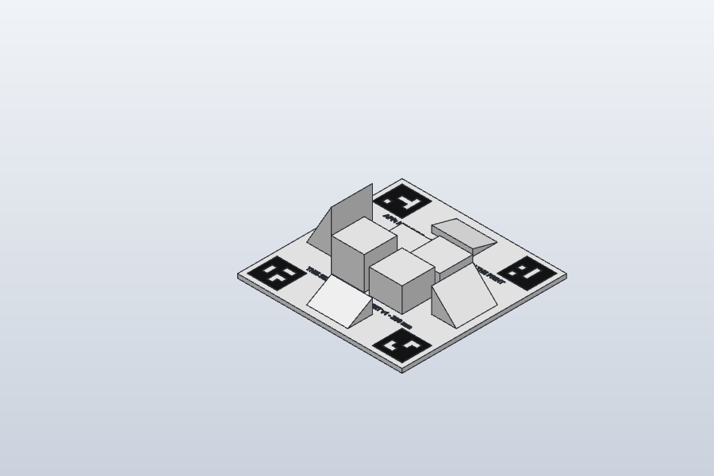
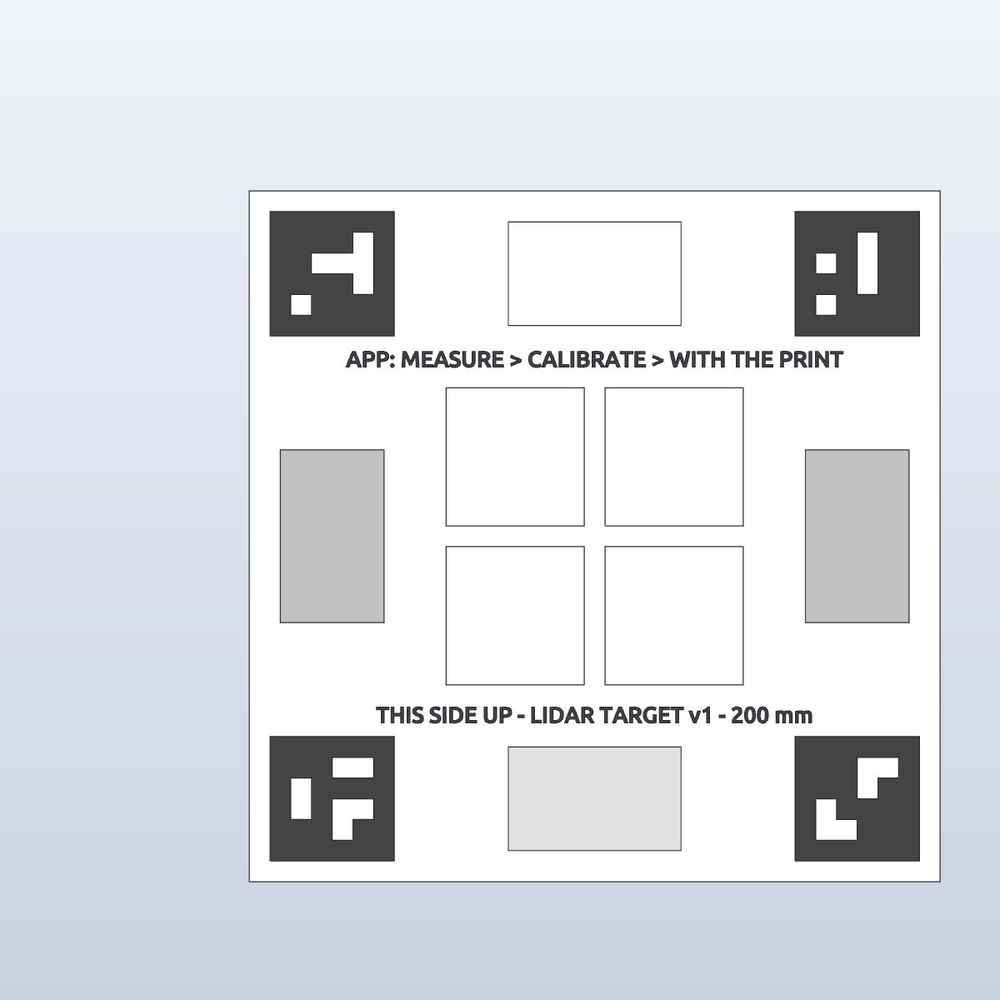

# LiDAR calibration print (lidar-target v1)

A 3D-printed target that tells the phone how wrong its LiDAR is, at which distances and at which angles, against a print whose
size is known. The camera reads four printed markers to know exactly where the phone is relative to the print, so every
LiDAR pixel that lands on the print has a known true depth. Thousands of those, from 11 positions, give the correction.

 

Files (in `prints/lidar-target/`, the 3MF and STLs are also served by the server at `/prints/`):

| File | What |
|---|---|
| `lidar-target-v1.3mf` | Both colours, one object per body (70: the plate, 4 markers, 65 letters). The two STLs are easier in the slicer |
| `lidar-target-v1-white.stl` | The plate, pads and wedges (white) |
| `lidar-target-v1-black.stl` | The 4 markers and the text (black) |
| `lidar-target-v1.step` | For CAD |
| `lidar-target-v1.solidcraft` | The SolidCraft design (timeline: Plate, Pad10..Pad40, Wedge15..Wedge60, Marker40..43 with their cuts, Label) |

## 1. Printing it (Snapmaker U1, 2 colours)

1. Open Snapmaker Orca, U1 profile. **File > Import** both STLs at once. When asked "load as a single object with
   multiple parts", answer **Yes** (that keeps the black exactly on top of the white).
2. Filament 1 = **matte white PLA** (white reads best for LiDAR and gives the camera contrast), filament 2 = **matte black PLA**.
   Assign the `black` part to filament 2. Glossy filament is the one thing to avoid: reflections throw the LiDAR and the markers.
3. Settings: 0.4 mm nozzle, **0.2 mm layers** (the black is exactly the last 2 layers), 3 walls, 15% infill, no supports
   (nothing overhangs: the wedges slope outward from a vertical inner face), brim off (the plate is 200 x 200 mm, plenty of
   bed contact), textured or smooth PEI both fine. The U1 changes tools, so no purge tower waste beyond the default.
4. Size on the bed: 200 x 200 x 57 mm (the U1 takes 270 x 270 x 270). About 3-4 hours, about 230 g white, 3 g black.
5. Check the print:
   - the four black squares are crisp, with clean white cells (a blob in a cell makes that marker unreadable);
   - the text reads **THIS SIDE UP - LIDAR TARGET v1 - 200 mm** and **APP: MEASURE > CALIBRATE > WITH THE PRINT**;
   - it lies flat: put it on a table, a sheet of paper must not slide under any edge;
   - optional: measure across the plate with a ruler or calipers and type it into the app (PLA shrinks a few tenths of a
     percent; the app accepts 180-220 mm and scales the whole model by it).

## 2. Using it (the app does the guiding)

App: **Measure** tab > **Calibrate** > **With the print (guided)** (also in Settings > Calibrate LiDAR with the print).

1. Lay the print flat on a table, text the right way up, good even light (no sun patches).
2. Point the crosshair at the middle of the print, about 40 cm away, and tap **This is the middle**. A teal ring appears on the
   print: from now on ARKit tracks it, so the app always knows your **distance** to the print and your **tilt** (0 = looking
   straight down at it).
3. The screen shows a grid of 11 stations (distance 30 / 50 / 80 / 120 cm across, tilt down / 30° / 55° down the side) and the
   live readout: distance now -> wanted, tilt now -> wanted, aim, steady. The top line says the one thing to do next
   ("Move back 20 cm", "Move out to the side and lower the phone", "Hold still..."). Any order works: whenever you are at a
   station that still needs photos and hold still, it takes 3 photos by itself (a tap of the phone each, a stronger one when the
   station is done) and ticks it off.
4. With 3 or more stations done (all 11 is best, about 3 minutes), tap **Send and calculate**. The server answers in a few
   seconds with the error before and after, the left-over error by distance and by angle, and how ARKit's own scale compares
   with the print. **Use this correction for measuring** makes the Measure tab use it (tape checks, if you add any, still win).

Why the phone alone is enough: ARKit tracks the print at 60 fps on the phone, no network needed while you move. The precise part
(reading the markers, fitting) runs on the server afterwards from the photos; the photos and the result are kept in
`data/lidarcal/<time>/` so a better analysis can be re-run on them later.

## 3. The geometry (exact, for rebuilding or changing it)

Units mm. Origin = centre of the plate's **bottom** face, **Z up**, **+Y towards markers 40 and 41** (the top of the text).
`server/app/lidartarget.py` holds the same numbers; change both together and bump `VERSION`.

| Part | Where | Size |
|---|---|---|
| Plate (white) | x, y in [-100, 100], z in [0, 5] | 200 x 200 x 5 |
| Pad 10 (white) | centre (-23, +23) | 40 x 40, top at z = 15 |
| Pad 20 | centre (+23, +23) | 40 x 40, top at z = 25 |
| Pad 30 | centre (+23, -23) | 40 x 40, top at z = 35 |
| Pad 40 | centre (-23, -23) | 40 x 40, top at z = 45 |
| Wedge 15° (white) | +Y edge: y 61..91, x -25..25 | high side (8.04 mm) at y = 61, slope down to 0 at y = 91 |
| Wedge 30° | -Y edge: y -61..-91, x -25..25 | 17.32 mm high at y = -61 |
| Wedge 45° | +X edge: x 61..91, y -25..25 | 30.00 mm high at x = 61 |
| Wedge 60° | -X edge: x -61..-91, y -25..25 | 51.96 mm high at x = -61 |
| Markers (black) | centres (-76, +76) id 40, (+76, +76) id 41, (+76, -76) id 42, (-76, -76) id 43 | 36 x 36 (6 x 6 cells of 6 mm), z 5 to 5.4 |
| Text (black) | baselines y = +49 and y = -54, centred on x = 0 | Ubuntu Bold, 4.5 mm caps, z 5 to 5.4 |

Wedge heights are 30 mm x tan(angle). Slopes face outward, so from straight above the beam meets them at exactly 15/30/45/60°.

Markers: ArUco **DICT_4X4_50**, ids 40-43 (the turntable ring uses 0-17, so the two never get mixed up). Each marker is a black
36 mm square with its white cells cut out; rows top (+Y) to bottom, columns left (-X) to right, 1 = black:

```
id 40        id 41        id 42        id 43
111111       111111       111111       111111
111101       111011       111001       111001
110001       101011       111011       101111
111101       111011       101111       101001
101111       101111       100111       111011
111111       111111       111111       111111
```

OpenCV's corner order for each marker (top-left, top-right, bottom-right, bottom-left of the marker image) is, in plate
coordinates, (cx-18, cy+18), (cx+18, cy+18), (cx+18, cy-18), (cx-18, cy-18), all at z = 5.4.

Rebuilding it in SolidCraft (what was done, 4 batches, every volume checked):

1. `solid.box` 200 x 200 x 5 centred at (0, 0, 2.5), body `target_white`; 4 x `solid.box` pads with `operation: join`,
   `targets: ["target_white"]`, centre z = 5 + h/2. Volume 360 000 mm³.
2. Each wedge: a closed triangle `sketch.line` on plane `YZ` (wedges on ±Y; sketch x = +Y, y = +Z) or `XZ` (wedges on ±X;
   sketch y = **-Z**), e.g. 15°: (61, 5), (91, 5), (61, 13.0384); `solid.extrude` 50, `direction: symmetric`, `operation: join`.
   Volume 440 490.3 mm³ with all four.
3. Each marker: `solid.box` 36 x 36 x 0.4 at (cx, cy, 5.2), `operation: new`, body `black_m<id>`; then one `solid.box` cut per run of
   white cells in a row (6 mm high cells, 1 mm tall cutter at z 5.2, `targets: ["black_m<id>"]`). Black volume 518.4 - 14.4 per
   white cell: 432 / 446.4 / 432 / 417.6 mm³.
4. `sketch.create` XY offset 5, two `sketch.text` (font `Ubuntu`, bold, height 4.5, centred), `solid.extrude` 0.4 new.
   Colour: `appearance.assign` white `#f2f2f2`, black `#151515`. Export 3MF/STL/STEP.
5. Check: render the top view and run OpenCV's ArUco detector on it: ids 40, 41, 42, 43 must come back top-left, top-right,
   bottom-right, bottom-left. A mirrored or rotated marker either does not decode or decodes in the wrong corner.

Rules if you change it: keep a white margin of at least one cell (6 mm) round every marker; keep tall parts away from the
markers so they are not hidden at 55° tilt; keep everything matte; keep the markers flat on the plate (the analysis assumes all 16
corners lie at z = 5.4).

## 4. How the numbers are worked out (server)

`POST /api/lidar-cal` (photos + depth + `photos.json` + optional `print_scale`), `GET /api/lidar-target` (stations, tolerances),
`GET /api/lidar-cal/latest`. For each photo:

1. **Camera pose from the markers.** Detect DICT_4X4_50 markers 40-43 (sub-pixel corners), solve the pose from all their
   corners with SQPnP (not IPPE: IPPE assumes the points lie at z = 0) and refine it (Levenberg-Marquardt). Needs 2 markers.
   ARKit's intrinsics are used with the principal point moved by half a pixel (OpenCV puts pixel centres at whole numbers).
2. **True depth per LiDAR pixel.** Each depth pixel's ray (through its centre, with the intrinsics scaled to 256 x 192) is cast
   against the target, built from convex pieces (plate, pads, wedges, markers as half-spaces). That gives the depth it should
   read (z along the optical axis, the same as LiDAR reports), the face it hits and the angle of incidence. Pixels within 2 of a
   face boundary are left out (LiDAR blurs edges), and so are pixels off the print.
3. **Station.** The camera's distance to the plate's centre and its tilt from straight down put the photo on a station
   (within 15% and 7°).

Then all frames together (at most 4000 pixels per frame, so a close-up does not outweigh the rest):

- `true = a * measured + b`, least squares, refitted without points more than 3 robust sigmas (and over 5 mm) off. The same form
  as the app's tape calibration, so it slots straight into the Measure tab.
- The error left after the correction, by true distance (0-0.4, 0.4-0.65, 0.65-1, 1-1.5 m) and by angle of incidence (15° bins):
  this shows whether steep surfaces read long or short, which a single scale and offset cannot fix.
- **Camera against the print**: the camera positions from the markers (metric, from the printed size) against ARKit's camera
  positions for the same photos, as the median ratio of the distances between pairs: 1.000 means ARKit's metres are the print's.
- `good` when the error after is under 15 mm, the scale within 10% of 1 and the offset under 5 cm.

Tested on synthetic frames (photos with the markers drawn in by homography, depth cast from the model with a known error):
a LiDAR that reads true = 1.02 x measured - 8 mm comes back as 1.02 / -8 mm within 0.4% / 2 mm, every frame lands on its
station, ARKit-vs-print 1.00 (`server/tests/test_lidartarget.py`). Not yet tried with a real print and phone.
