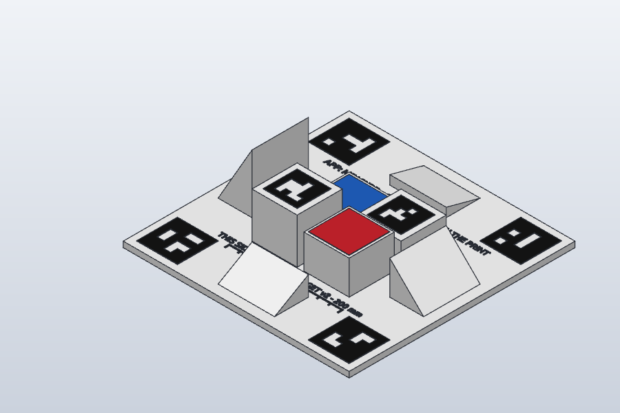
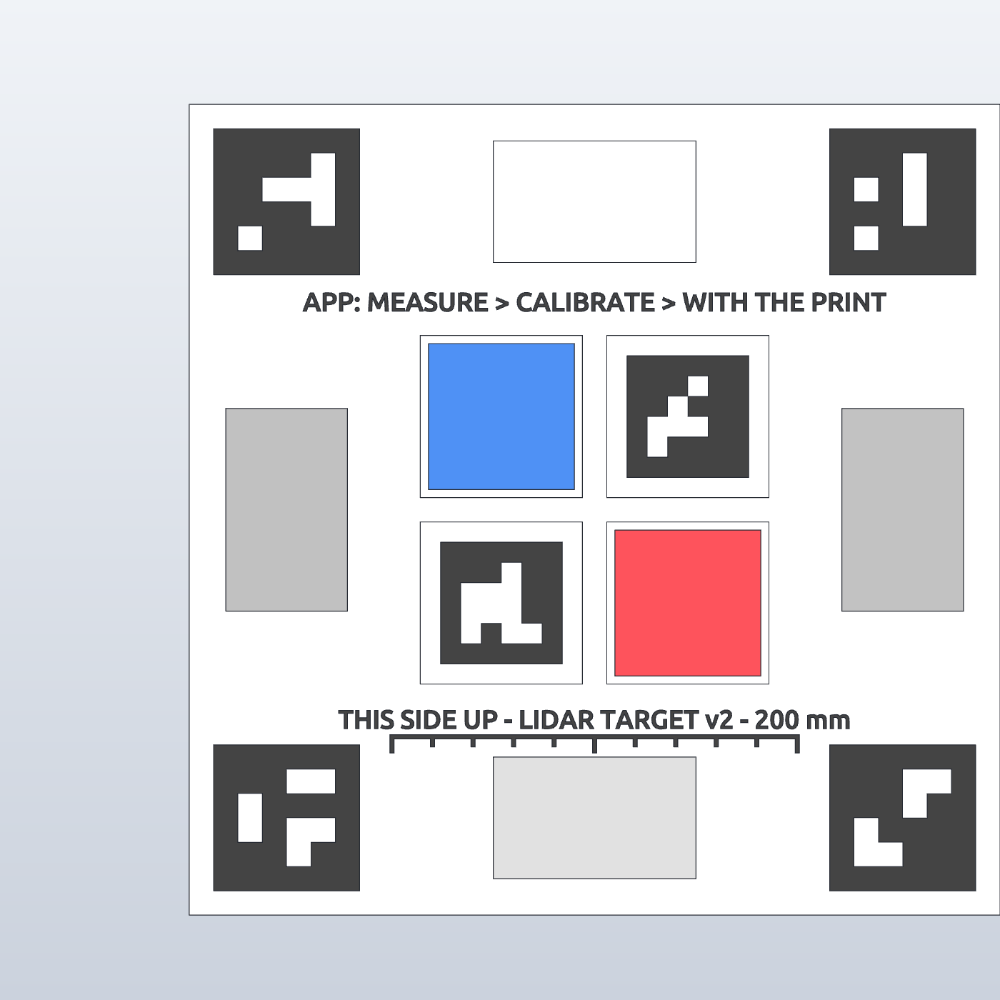

# LiDAR calibration print (lidar-target v2)

A 3D-printed target that tells the phone how wrong its LiDAR is, at which distances, at which angles and on which colours,
against a print whose size is known. The camera reads six printed markers (at three heights) to know exactly where the phone is
relative to the print, so every LiDAR pixel that lands on the print has a known true depth. Thousands of those, from 11
positions, give the correction.

 

Files (in `prints/lidar-target/`, see [prints/README.md](../prints/README.md); the 3MF is also served by the server at `/prints/`):

| File | What |
|---|---|
| `3mf/lidar-target-v2-4colour.3mf` | **Use this one.** One object, four parts, coloured and already on filaments 1-4: `white` 1, `black` 2, `blue` 3, `red` 4 |
| `stl/lidar-target-v2-white.stl`, `-black.stl`, `-blue.stl`, `-red.stl` | The same four parts as meshes |
| `cad/lidar-target-v2.step` | For CAD |
| `cad/lidar-target-v2.solidcraft` | The SolidCraft design |

(v1, with four markers and two colours, was never printed and is not supported.)

## 1. Printing it (Snapmaker U1, 4 colours)

1. Open **lidar-target-v2-4colour.3mf** in Snapmaker Orca. It is one object with four parts (the Objects list shows white, black,
   blue, red), each already on its filament slot, with the U1 settings inside. **Check before printing:** the model shows all four
   colours, and after Slice the Preview shows a weight for all four filaments. Put **matte white PLA** in slot 1, **matte black** in 2, **blue** in 3, **red** in 4. No blue or red? Set
   those two parts to white: only the colour test is lost.
2. **Matte matters most**: turn **ironing off** (it makes the top shiny) and do not use silk or glossy filament. Reflections throw
   both the LiDAR and the marker reading.
3. Settings: 0.4 mm nozzle, **0.2 mm layers** (every coloured part is exactly the last 2 layers of its surface), 3 walls,
   15% infill, no supports (nothing overhangs: the wedges slope outward from a vertical inner face), no brim. The U1 changes
   tools, so the extra colours cost no purge tower.
4. Size on the bed: 200 x 200 x 57 mm (the U1 takes 270 x 270 x 270). About 3-4 hours, about 230 g white, a few grams of each other colour.
5. Check the print:
   - the six black squares are crisp, with clean white cells (a blob in a cell makes that marker unreadable);
   - the text reads **THIS SIDE UP - LIDAR TARGET v2 - 200 mm** and **APP: MEASURE > CALIBRATE > WITH THE PRINT**;
   - it lies flat: put it on a table, a sheet of paper must not slide under any edge;
   - measure the **ruler** under the bottom text with calipers: from the outer edge of the first long tick to the outer edge of
     the last is **101.0 mm** (the ticks are 1 mm wide, 10 mm apart, centre to centre 100 mm). Type what the calipers read into
     the app's **Ruler reading** field: it works out the print's scale itself (PLA shrinks a few tenths of a percent).

## 2. Using it (one motion, about a minute)

App: **Measure** tab > **Calibrate** > **With the print (guided)** (also in Settings > Calibrate LiDAR with the print).

Lay the print on a **bare, hard floor** (not a rug) with a metre of clear floor round it, in even light (no sun patches). The floor matters: it gives far more depth points than the print, and it is what makes far distances and steep angles measurable.

1. Hold the phone flat over the middle of the print, about 40 cm up, and tap **Start**. A teal ring marks the print. The screen stays on and a voice says what to do.
2. **Stand up** slowly with the phone flat over the print (30 to about 150 cm).
3. **Step back**: stand over the print, then walk slowly backwards keeping it in the middle of the screen (tilt 10 to 60°). The screen keeps facing you.
4. **Another side**: walk round about a quarter turn and step back the same way.

There are no angles or distances to hit: the app takes the photos itself, a tap and a tick for each, and fills a bar. If you can't reach a band, **Next step** appears once there is enough. At the end it sends the photos and answers in one sentence, for example "Your LiDAR reads 5 mm long looking straight at a surface and 2 mm long at 60°. After the correction, ±5 mm is left." A good result is used for measuring straight away. If something is wrong it says the one thing to do and offers **Try again**.

The photos and the result are kept in `data/lidarcal/<time>/` so a better analysis can be re-run on them later.

## 3. The geometry (exact, for rebuilding or changing it)

Units mm. Origin = centre of the plate's **bottom** face, **Z up**, **+Y towards markers 40 and 41** (the top of the text).
`server/app/lidartarget.py` holds the same numbers; change both together and bump `VERSION`.

| Part | Colour | Where | Size |
|---|---|---|---|
| Plate | white | x, y in [-100, 100], z in [0, 5] | 200 x 200 x 5 |
| Pad 10 | white | centre (-23, +23) | 40 x 40, top at z = 15 |
| Pad 20 | white | centre (+23, +23) | 40 x 40, top at z = 25 |
| Pad 30 | white | centre (+23, -23) | 40 x 40, top at z = 35 |
| Pad 40 | white | centre (-23, -23) | 40 x 40, top at z = 45 |
| Wedge 15° | white | +Y edge: y 61..91, x -25..25 | high side (8.04 mm) at y = 61, slope down to 0 at y = 91 |
| Wedge 30° | white | -Y edge: y -61..-91, x -25..25 | 17.32 mm high at y = -61 |
| Wedge 45° | white | +X edge: x 61..91, y -25..25 | 30.00 mm high at x = 61 |
| Wedge 60° | white | -X edge: x -61..-91, y -25..25 | 51.96 mm high at x = -61 |
| Markers 40-43 | black | centres (-76, +76) 40, (+76, +76) 41, (+76, -76) 42, (-76, -76) 43 | 36 x 36 (cells of 6 mm), z 5 to 5.4 |
| Marker 44 | black | on pad 20, centre (+23, +23) | 30 x 30 (cells of 5 mm), z 25 to 25.4 |
| Marker 45 | black | on pad 40, centre (-23, -23) | 30 x 30 (cells of 5 mm), z 45 to 45.4 |
| Patch | blue | on pad 10, centre (-23, +23) | 36 x 36, z 15 to 15.4 |
| Patch | red | on pad 30, centre (+23, -23) | 36 x 36, z 35 to 35.4 |
| Text | black | baselines y = +49 and y = -54, centred on x = 0 | Ubuntu Bold, 4.5 mm caps, z 5 to 5.4 |
| Ruler | black | baseline y -56.5..-55.5, x -50.5..50.5; ticks every 10 mm (x = -50..50), 1 mm wide, down to y -58.5 (long ones at 0, 50, 100 mm: -60) | z 5 to 5.4 |

Wedge heights are 30 mm x tan(angle). Slopes face outward, so from straight above the beam meets them at exactly 15/30/45/60°.

Markers: ArUco **DICT_4X4_50**, ids 40-45 (the turntable ring uses 0-17, so the two never get mixed up). Each is a black square
with its white cells cut out (the cutters 0.1 mm larger than a cell, so white cells that touch only at a corner join cleanly);
rows top (+Y) to bottom, columns left (-X) to right, 1 = black:

```
id 40    id 41    id 42    id 43    id 44    id 45
111111   111111   111111   111111   111111   111111
111101   111011   111001   111001   111011   111011
110001   101011   111011   101111   110111   100011
111101   111011   101111   101001   100011   100011
101111   101111   100111   111011   101111   101001
111111   111111   111111   111111   111111   111111
```

OpenCV's corner order for each marker (top-left, top-right, bottom-right, bottom-left of the marker image) is, in plate
coordinates, (cx-h, cy+h), (cx+h, cy+h), (cx+h, cy-h), (cx-h, cy-h) with h = half its side, at the top of the marker (its surface
+ 0.4). Corners at z = 5.4, 25.4 and 45.4: three heights, which pins the camera's tilt and distance apart far better than one plane.

Rebuilding it in SolidCraft: the design has 18 timeline items in 2 folders and 13 parameters (`plate`, `plate_t`, `inlay`, `pad`, `pad_at`, `pad1`-`pad4`, `patch`, `wedge_in`, `wedge_run`, `wedge_w`). The marker cells are fixed numbers on purpose: they are the spec the server reads.

**White shape** (body `white`)

1. `Sk_Plate`, `Plate`: the outline, extruded `plate_t`.
2. `Sk_Pads` (master sketch on top of the plate, 4 squares), `Pad1`-`Pad4`: one extrude per height, each picking its square.
3. `Sk_Wedges_15_30`, `Wedges_15_30` and `Sk_Wedges_45_60`, `Wedges_45_60`: two triangles per sketch, on planes given as `{origin, x_dir, y_dir: [0,0,1]}` so the sketch's y is the world Z, extruded `wedge_w` symmetric, heights `wedge_run * tan(angle)`.

**Colour layers** (bodies `black`, `blue`, `red`, all `inlay` thick)

4. `Sk_PadTops` (master sketch at z = 0: markers 44 and 45, both patches), `BluePatch`, `RedPatch`, `Marker44`, `Marker45`: each picks its profile and starts at its pad's top with `start_offset`.
5. `Sk_PlateTop` (markers 40-43, ruler, both text lines), `BlackOnPlate`: one extrude joined into `black`, so all the black is one body without a slow Combine.

Each marker is one rectangle plus closed outlines of its white cells, every cell 0.1 mm larger so cells touching at a corner merge. Check: render the top view and run OpenCV's ArUco detector: 40 top-left, 41 top-right, 42 bottom-right, 43 bottom-left, 44 right of centre at the top, 45 left of centre at the bottom. A mirrored marker does not decode.

**3MF:** export one STL per colour and write Orca's own project format (`3D/Objects` with one object per part, `Metadata/model_settings.config` with each part's `extruder`, `Metadata/project_settings.config` with the U1 settings and filament colours). The PrusaSlicer-style config does **not** work: Orca merges the parts into one and prints everything on filament 1. Place the object at the bed centre (135.5, 136), not at (0, 0).

Rules if you change it: keep a white margin of at least one cell round every marker; keep tall parts away from the markers so
they are not hidden at 55° tilt; keep everything matte.

## 4. How the numbers are worked out (server)

`POST /api/lidar-cal` (photos + depth + `photos.json` + optional `print_scale`), `GET /api/lidar-cal/latest`. For each photo:

1. **Camera pose from the markers.** Detect DICT_4X4_50 markers 40-45 (sub-pixel corners), solve the pose from all their corners with SQPnP (not IPPE: IPPE assumes the points lie at z = 0) and refine it. Needs 2 markers. On the first real session the plate's normal agreed with ARKit's gravity within 1° on every photo.
2. **Line the depth up.** The stored depth map is turned 90° from the photo: see below.
3. **True depth per LiDAR pixel.** Each depth pixel's ray is cast at the plate's flat top, and off the print at the floor (z = 0) in a ring out to 50 cm. A frame's floor counts only if it is flat (spread under 12 mm) and level with the plate (within 10 mm), so a rug or a table's edge drops out by itself.

Then all frames together, flat surfaces only (at most 4000 pixels of each per frame): `true = a * measured + b + h(angle)`, with `h` straight-line between 0, 15, 30 and 45° and 0 at 0°, flat past 45° (at 60° two sessions gave 3 and 27 mm; at 30° and 45° they agreed within 1 mm), refitted without points over 3 robust sigmas (and 5 mm) off. The app's Measure tab applies `a`, `b` and `h`, working out the angle from how fast the depth changes round the crosshair. `good` when the leftover is under 10 mm, the scale within 10% of 1 and the offset under 5 cm.

**Why the pads and wedges are not fitted:** even correctly lined up they read 10-30 mm off. LiDAR has only a few hundred real dots, spread into its depth image, so a 40 mm pad at 45 cm is blurred into its surroundings. They remain useful as marker carriers. Because of that blur, the colour figures for blue and red (on pad tops) are not a true colour test on this print.

### The depth map is turned from the photo

`meshscan.align_depth` handles it for every server reader; the app's live point cloud does the same itself. A photo-grid column x is stored at row x - m and a photo-grid row y at column w - m - 1 - y, with m = (w - h) / 2 = 32, at the photo's scale (7.5 photo pixels per depth pixel). So the stored map covers the middle 75% of the photo's width and 133% of its height. Columns beyond the photo are dropped.

Straight at a flat surface both orientations look the same, which is how it stayed hidden. It was found on the first real calibration, where the print and floor have a known shape:

| Measure | Depth as stored | Turned |
|---|---|---|
| Error on tilted calibration frames (robust spread) | 157 mm | 7 mm |
| Frame-to-frame disagreement, calibration | 33 mm | 5.3 mm |
| Same, sweep b6776530ac8e | 189 mm | 31 mm |
| Same, sweep 2a132b51eca0 | 260 mm | 55 mm |

Apple documents the depth map as lined up with the camera image, so why this phone stores it turned is not known. It has only been measured on one phone (iPhone 13 Pro, iOS 18.7): check it again on any other device with the frame-to-frame test.

First real session (29 usable photos, this print on a wooden floor): scale 0.9992, offset -4.3 mm, ±4.8 mm left over at every distance from 0.2 to 1.2 m. Tests use synthetic frames with a known error, including floor and angle error (`server/tests/test_lidartarget.py`).
